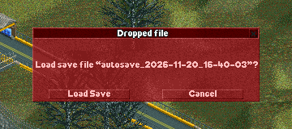

<!--What's up gamers, -->OpenLoco v26.11 has been released!
<!-- say something nice and succinct that summarises the update here -->

As always, please find the [download](https://openloco.io/download/)
on our website, and you can find the full
[changelog](https://github.com/OpenLoco/OpenLoco/blob/v26.11/CHANGELOG.md) on GitHub.

## OpenGraphics

<!-- TODO: write summary better -->
New Great Britain Expansion region! Vanilla replacements for various GB vehicles, the fountain and the park, plus several new vehicles!
And updated various OpenGraphic GB vehicles for consistency with the rest of the set.

In total, 46 new objects and 20 updated objects!

<!-- TODO: who did what? -->
<!-- TODO: should use English names of objects instead of internal names -->
<!-- TODO: add bullet points OR commas between objects -->
<!-- OG_REGUS and OG_REGUK: vanilla replacements? Expansion? Both? -->

### New objects

#### Great Britain Expansion

OG_9F
OG_CL390D
OG_CL390P
OG_CL390W
OG_CL66
OG_CL70
OG_CL76
OG_CL91
OG_CL92
OG_MK4
OG_MK4DC
OG_PVAN3
OG_PVAN4
OG_PVAN5

#### North America Expansion

OG_TRAMU1
OG_TRAMU2
OG_TRAMU3
OG_TRAMU4
OG_TRAMU5

#### Vanilla Replacements

OG_REGUK
OG_BLDFOUNT
OG_BLDPARK1
OG_BLDPYLON
OG_SNDH1
OG_SNDH3
OG_114
OG_142
OG_158
OG_2EPB
OG_4MT
OG_508
OG_A4
OG_BLACK5
OG_CATTLE2
OG_CATTLE3
OG_CL20
OG_CL37
OG_CL47
OG_CL55
OG_CL58
OG_CL85
OG_CL86
OG_CL90
OG_EMU1
OG_PVAN2
OG_V2

### Updated objects

#### Vanilla Replacements

OG_REGUS
OG_4F
OG_A3
OG_APT1
OG_APT2
OG_APT3
OG_CL71
OG_ESTAR1
OG_ESTAR2
OG_HST
OG_JINTY
OG_MK1
OG_MK2
OG_MK3
OG_PCAR1
OG_PCAR2
OG_PVAN1
OG_ST8FT

#### North America Expansion

The OGE_DASH8 and OGE_E60C2 from the have had their horns fixed.

## Improved input handling

This month, @ZehMatt has improved how the game handles inputs.
Now when you are using VSync or an unlimited frame&shy;rate, your inputs will be processed at your frame&shy;rate instead of at Locomotion's original 40 Hz!

This means panning and scrolling the view and dragging windows will now be much smoother!
Right click dragging the view is also no longer limited by the edges of the screen.

## Load save and scenario files by drag & dropping them into the game window

Fed up with needing to navigate to the correct folder every time they wanted to check out a save file they had downloaded, @LeeSpork has introduced a new feature:
you can now drag & drop the file directly into the game window, and it will prompt you if you wish to load it.

This also works for Scenarios, and if you are in the Scenario Editor mode you can load files to be edited instead of played.

## Objects marked with source OpenLoco (OpenGraphics) are no longer exported in scenario or save files

If you have created saves using the North America Expansion set that we released in our previous update,
you might have noticed that the save file is quite a bit larger than normal.
@shusaura85 figured out the cause, and has corrected it!
It turns out the game was considering official OpenLoco objects to be plug-in objects,
and so was exporting them with saves, despite them already included with OpenLoco!

## Keyboard shortcuts

@LeeSpork split the existing 'Rotate View' keyboard shortcut into Clockwise and Anti-Clockwise,
so now keyboard shortcut users can finally rotate the view in both directions!

They have also made the numeric keypad enter key work the same as the return key for confirming text input and save prompts.

Another thing to note, we forgot to mention in the news post for our previous release that since 26.09,
the track/road type now cycles on repeated presses of the Build Tracks and Build Roads keyboard shortcuts.
No more needing to move your mouse all the way to the top toolbar when it opens tram track instead of railroad track!

## UI

New contributor @Abrocat improved the Company List window, adding text to the Speed Records tab when there are no records.
Thanks to them this screen is no longer completely blank at the start of a game!

@LeeSpork improved the Landscape Generation window.
Now river options are disabled when the number of rivers is set to 0 and when using 'flat land' topography,
and the topography options are now disabled when using a PNG height&shy;map file.
They have also fixed an issue where it was possible to proceed in the Scenario Editor without generating a PNG height&shy;map,
which lead to scenarios that did not work correctly!

## Improved company takeover cheat

@AaronVanGeffen has made the company asset acquisition cheat work much better.
The colours of acquired vehicles are now reset to be your colours,
you no longer inherit the AI company's invisible 'planned' track,
and the AI company is now set to shut down after you take it over.

@LeeSpork also fixed the acquire company assets cheat not properly transferring station elements to your ownership.

## Other bug fixes

@duncanspumpkin fixed a bunch of issues from the original game,
which we can do now that the game is fully reimplemented and we can confidently diverge from the original behaviour:
industries with re&shy;colourable sprites now select a random colour,
AI no longer fails to create road at some rotations,
road path&shy;finding no longer uses incorrect road length values,
vehicle speed calculation has been corrected,
and town expansion no longer fails to raise/lower certain land corners.

@Abrocat also fixed a crash when starting the game when am empty configuration file, and when it isn't following the correct YAML schema.

New contributor @skrolikowski fixed an issue where the screen mode and display resolution options weren't being disabled on MacOS as intended.

@AaronVanGeffen fixed cargo production strings using the singular unit when the production was 0.

@ZehMatt fixed the intro sequence not playing when starting the game with the `--intro` argument.
